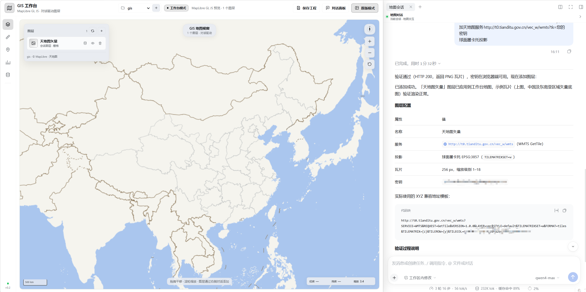

# GIS workbench

A **DeepSeek Harness (DSH) workbench plugin** (`@focus-daima/gis-workbench`) that
embeds a MapLibre GL JS GIS console directly into the Harness web app. It lets the
Harness conversation inspect, style, import, and persist spatial datasets and map
layers on a shared map canvas.

After the plugin is installed, open any Harness session and click the **GIS**
button in the **top-right corner** to enter the GIS workbench. Choose **Original
layout** in the workbench top bar to go back to the Harness session.

The plugin adds:

- a MapLibre GL JS workbench panel with an **empty initial layer list**;
- a collapsible right-side conversation panel;
- a Host tool `gis_add_layer` that the conversation calls to add raster layers;
- a Client tool view that applies each successful add-layer result to the map store.

## Screenshots

**Entry point — the GIS button in the Harness session header (top-right corner):**


**GIS workbench — map canvas, layer panel, and map conversation:**



## Installation in another DSH profile

The package is published to the internal Nexus npm hosted repository
`https://your-nexus-host/repository/frontend/`.

Configure the scope once for the target user:

```bash
npm config set @focus-daima:registry https://your-nexus-host/repository/frontend/
dsh plugin --profile web add @focus-daima/gis-workbench@0.9.10
dsh web
```

A local tarball also works:

```bash
npm pack
dsh plugin --profile web add ./focus-daima-gis-workbench-0.9.10.tgz
```

Required runtime: Node.js with `node:sqlite`, GDAL CLI (`ogr2ogr`,
`gdal_translate`, `gdalinfo`, `gdal2tiles.py`), and Python 3 with GDAL
bindings. PostGIS registration additionally needs `psycopg`.

The default Tianditu tile service is deployment-specific. Replace
`DEFAULT_TILE_URL` in `shared.js` or configure the tile URL through the API if
the target Harness cannot reach the current internal service.

## Source and build

`client.js` is generated by esbuild from `src/client.entry.js`. It bundles
`maplibre-gl@5.24.1` and inlines `maplibre-gl/dist/maplibre-gl.css`. MapLibre is the
open-source fork of Mapbox GL JS and needs no access token.

Mapbox GL JS 3.x revokes the renderer when no valid access token is configured:
the map keeps requesting raster tiles (they answer 200) but paints a blank
canvas. That is why this plugin uses MapLibre instead. Switching back to
Mapbox requires setting a real token before creating the map.

The dependency and bundler were installed from the Nexus npm registry:

```bash
npm install --registry=https://your-nexus-host/repository/nexus-npm/ \
  maplibre-gl@5.24.1 esbuild@0.28.2
```

Build from the repository root after making the installed `node_modules`
available to esbuild:

```bash
./node_modules/.bin/esbuild src/client.entry.js \
  --bundle --format=iife --platform=browser --target=es2020 \
  --loader:.css=text --define:process.env.NODE_ENV='"production"' \
  --minify --legal-comments=inline --outfile=client.js
```

## Default tile layer

`shared.js` owns the default Tianditu image template:

```text
//your-tile-host/api/gis-map-service/world-map-tiles/images/tiandi-image-3857/{z}/{x}/{y}
```

Calling `gis_add_layer` with no arguments adds this layer. The Client resolves
the protocol-relative template against the page protocol before handing it to
the map engine.

## Shared map chat

The right-hand map chat uses the **current Session** rather than a separate
Session. DSH's right sidebar is session-bound: showing a separate Session's chat
requires navigating the main workspace to that Session, which can expose a
duplicate conversation if the workbench overlay is lost. Using the current
Session keeps the main workspace fixed while the overlay covers it.

- Opening the workbench opens the map-chat tab in the current Session's right
  sidebar and leaves the main Session unchanged.
- The chat and the center conversation share model context, history, and draft,
  but the overlay hides the center while the workbench is open.
- **Original layout** closes the overlay, closes the map-chat tab, and restores
  the previous right-sidebar tab.
- Map layers live in one module-level store, so tool calls from the chat update
  the same workbench map.

## Layout entry points

- **GIS** button in the session header enters the workbench.
- **Original layout** in the workbench top bar returns to the previous Session.
- The right panel can be collapsed from its own chevron or the top-bar
  **Conversation** control.
## Projects, datasets, and layers

State is persisted in SQLite at `<Host workspace>/.gis-workbench/gis.sqlite`
(the Host workspace is `/app` in the current deployment; uploaded files go to
`.gis-workbench/uploads`). The Host plugin exposes:

```text
GET    /api/gis-workbench
POST   /api/gis-workbench/projects
GET    /api/gis-workbench/projects/:id/datasets
POST   /api/gis-workbench/projects/:id/datasets
POST   /api/gis-workbench/projects/:id/datasets/upload
POST   /api/gis-workbench/projects/:id/datasets/tile
GET    /api/gis-workbench/projects/:id/layers
POST   /api/gis-workbench/projects/:id/layers
PATCH  /api/gis-workbench/layers/:id
DELETE /api/gis-workbench/layers/:id
DELETE /api/gis-workbench/datasets/:id
GET    /api/gis-workbench/datasets/:id/content
GET    /api/gis-workbench/browse?path=...
```

Tables follow the requested model: `projects`, `datasets`, `layers`. SQLite has
no built-in geometry type, so `bbox` is a JSON array
`[west, south, east, north]` (WGS84). `meta`, `profile`, and `style` are JSON
text columns. Foreign keys cascade dataset deletion to its layers.

Datasets can be:

- browsed from an allowed server directory (default roots: the Host workspace,
  `/home/agent`, `/data`, `/mnt/data`, `/srv/data`; override with the
  colon-separated `GIS_WORKBENCH_ROOTS` environment variable);
- uploaded as GeoJSON, JSON, CSV, GeoTIFF, PNG/JPEG/WebP, `.shp`, or `.zip`;
- registered from an XYZ tile URL.

The map renders tile datasets, GeoJSON datasets through the same-origin content
route, and image datasets with a known bbox. GeoTIFF and Shapefile datasets are
registered and managed but need tiling/conversion before they can be drawn.


## Saving project layer state

Layer visibility, ordering, and removal are edited locally so the map updates
immediately. The top-bar **Save project** button commits the complete project
layer list atomically through `PUT /api/gis-workbench/projects/:id/state`;
the Host replaces that project's layers in one SQLite transaction. Leaving the
workbench, switching projects, opening the dataset manager, or creating a
project saves unsaved layer edits first. A dirty indicator and a browser
unload warning remain until the save succeeds.

## Chunked, resumable uploads

The upload tab no longer sends the whole file in one multipart request, so the
old 200 MB request-body limit does not apply. Files are capped at **100 GB** and
uploaded in 8 MB chunks:

```text
POST   /api/gis-workbench/projects/:id/uploads/init
GET    /api/gis-workbench/uploads/:id
PUT    /api/gis-workbench/uploads/:id/chunks/:index
POST   /api/gis-workbench/uploads/:id/complete
DELETE /api/gis-workbench/uploads/:id
```

`uploads` rows in SQLite track the file fingerprint, chunk size, received chunk
indexes, and temporary path. Re-selecting the same file resumes from the server's
recorded chunks; the client also remembers the upload id in `localStorage`. The
upload tab shows byte/percentage progress and a pause button. The Host accepts
each chunk up to 64 MB and writes it at its final offset, so neither memory nor
the HTTP body limit scales with the whole file.

## GeoTIFF → COG and display

A `.tif`/`.tiff` dataset is converted during registration (and can be converted
again for an existing dataset from the dataset card):

1. `gdal_translate -of COG` writes `derived/<datasetId>/data.cog.tif` with
   DEFLATE compression and COG overviews;
2. `gdalinfo -json` supplies the WGS84 extent and CRS;
3. `gdal2tiles.py --xyz -p mercator -z 0-<cap>` writes an XYZ PNG pyramid under
   `derived/<datasetId>/tiles`;
4. the dataset profile becomes `format: "cog"` with `minzoom`, `maxzoom`,
   `tilesUrl`, and the map adds a raster source using
   `/api/gis-workbench/datasets/:id/tiles/{z}/{x}/{y}.png`;
5. the map fits the layer's WGS84 bounds.

The zoom cap is derived from the raster's geographic coverage (at most zoom 22,
and fewer levels for large extents, keeping the pyramid under roughly 6,000
tiles) to bound tile generation. The original TIF is preserved in the upload
directory; the dataset URI points at the derived COG.

## Vector import: SHP, GeoJSON, GeoPackage, and ZIP

Vector uploads are normalized into a project-scoped GeoPackage
(`data/projects/<projectId>.gpkg`) with one layer per imported dataset. The
original upload stays in the upload directory as the immutable source; the
catalog SQLite stores the dataset/layer metadata and the GeoPackage table name.

- `.geojson` / GeoJSON `.json`: imported with `ogr2ogr` to GPKG, converted to
  EPSG:4326, with a spatial index and a derived GeoJSON display preview.
- `.shp`: imported when its sidecars (`.shx`, `.dbf`, `.prj`, `.cpg`) are
  present. ZIP is the recommended upload for Shapefiles.
- `.gpkg`: every vector layer in the GeoPackage is imported as a separate
  dataset.
- `.zip`: safely extracted with a Python helper, then every contained SHP,
  GeoJSON, and GPKG layer is detected and imported. All supported sources in one
  archive produce multiple datasets/layers and are returned as arrays by the API.
- SHP/GeoJSON/GPKG are transformed to EPSG:4326 using `ogr2ogr -makevalid`; the
  GeoPackage remains the canonical editable/queryable store.
- MapLibre currently draws the derived GeoJSON preview. Large layers should be
  upgraded to MVT tiles later; the GPKG is already indexed for that step.

## Building labels

A vector layer whose name contains `building` and whose fields include `CODE`
gets a MapLibre symbol layer on top of its fill/line rendering. The `CODE`
value is translated for display:

| CODE | Label |
| --- | --- |
| Building | 建筑 |
| Deck | 露台 |
| Patio | 庭院 |
| Cement Pad | 混凝土地坪 |
| Greenhouse | 温室 |
| Foundation | 地基 |
| Ruins | 废墟 |

Unknown codes keep their original text, and null/empty codes draw no label.
Labels start at zoom 15; from zoom 12.5 only footprints larger than 10,000
(`ShapeSTAre`) are labelled so the overview stays readable. CJK glyphs are
rasterized locally by MapLibre, so no glyph PBF endpoint is required.

## Semantic layer styling tools

The Host exposes MCP-style map styling tools (visible to the conversation
agent), backed by the shared `style-schema.js` contract:

```text
gis_list_layers          find layers by name/project/field
gis_describe_layer       inspect format, fields, bbox, feature count, style
gis_sample_field         distinct field values for translation/valueMap
gis_map_capabilities     style schema, fonts, glyph URL, examples
gis_update_layer_style   persist a semantic style patch for one layer
```

`gis_update_layer_style` accepts `fillColor`, `fillOpacity`, `lineColor`,
`lineWidth`, `lineOpacity`, `circleColor`, `circleRadius`, `circleOpacity`,
`circleOpacity`, `lineVisible`, `circleVisible`, `categorical`, `opacity`, and `label`. Label supports `field`, `valueMap`, `fallback`, `size`,
`color`, `haloColor`, `haloWidth`, `minzoom`, `maxzoom`, `allowOverlap`, `font`,
and `anchor`. Example:

```json
{
  "fillColor": "#d8cbb4",
  "label": {
    "field": "CODE",
    "valueMap": {
      "Building": "建筑",
      "Deck": "露台",
      "Patio": "庭院"
    },
    "size": 12,
    "minzoom": 14
  }
}
```

Styles are persisted in `layers.style` and a client tool view applies the patch
to the live layer store. MapLibre renders labels as a symbol layer. Latin glyph
ranges are served from `assets/glyphs` at
`/api/gis-workbench/glyphs/{fontstack}/{range}.pbf`; missing CJK ranges fall
back to MapLibre's local ideograph renderer (`localIdeographFontFamily`).

## Map styling skill

A local skill at `/home/agent/.dsh/skills/gis-map-styling/SKILL.md` encodes the
general workflow: find layer → inspect fields → sample values → translate via
`valueMap` → persist the semantic style. The model-facing skill and the Host MCP
tools share the same style contract, so new layer-label or recolor requests do
not need a dedicated tool.

## PostgreSQL / PostGIS registration

The dataset manager has a **Database** tab. It registers a PostgreSQL
connection per project and lists spatial tables from PostGIS
`geometry_columns`. Selecting a table imports it into the project GeoPackage
with the same vector pipeline used for uploads, then adds it as a layer.

Endpoints:

```text
GET    /api/gis-workbench/projects/:id/databases
POST   /api/gis-workbench/projects/:id/databases
DELETE /api/gis-workbench/databases/:id
GET    /api/gis-workbench/databases/:id/tables
POST   /api/gis-workbench/databases/:id/tables/import
```

The registration stores host, port, database, username, password, and sslmode in
the catalog SQLite. Passwords are not returned by the API. Import uses
`ogr2ogr` with the GDAL PostgreSQL driver; the password is passed through
`PGPASSWORD`, not the command line. Tables are copied to the project GPKG, so a
later refresh/re-import is explicit rather than live-linked.

## Add a layer to the conversation

Right-click any row in the layer panel and choose **添加到对话**. The workbench
collects the layer name, layerId (or session layer key), project, dataset
type/format, feature count, attribute fields, bbox, and a short current-style
summary, then appends that structured context to the active map-chat draft. The
single action also opens/focuses the map-chat tab. A small composer-bridge slot
captures the active Session's `inputActions` so the overlay can write the draft
without replacing the main workspace.

## Layer ordering

Layer-panel rows are draggable. Dropping above/below another row reorders the
shared layer store immediately, normalizes `z`, and moves the corresponding
MapLibre layer groups to match. Reordering a project layer saves the project
layer order automatically; session-only ordering stays local.

## New polygon vector layers

The layer panel's **+** action creates a project-scoped GeoPackage polygon
layer (`sourceFormat: "drawn"`, fields `name` and `created_at`) and immediately
enters polygon drawing mode. Left-click adds vertices; right-click, **Finish**,
or the panel button closes the ring and saves the polygon through
`POST /api/gis-workbench/datasets/:id/features`. The layer preview and bbox are
rebuilt after each save, and the GeoJSON source is refreshed through a
feature-count/size version query. Escape cancels the drawing.

Drawn layers expose a pencil action in the layer panel to re-enter polygon
drawing and append more polygons to the same GeoPackage layer. During drawing
the map shows a rubber-band line from the last vertex and a live polygon preview
under the cursor; committed vertices and the preview use separate GeoJSON
sources so the preview can change on every mouse move.

Drawn polygons support right-click deletion. The map queries rendered features in
drawn layers, opens a small context menu on the polygon, and deletes the matching
feature by `name` + `created_at` through
`POST /api/gis-workbench/datasets/:id/features/delete`. The preview, feature
count, and actual bbox are rebuilt from the remaining features.

Drawn polygons support an edit mode from the pencil action: click a polygon to
show its vertices, drag a vertex marker to reshape it, or drag inside the
polygon to move the whole feature. Each drag finish saves geometry through
`POST /api/gis-workbench/datasets/:id/features/update`. Source refresh uses a
profile revision (`updatedAt`) instead of clearing project layers, preventing the
map from flashing white after edits or feature deletion.
