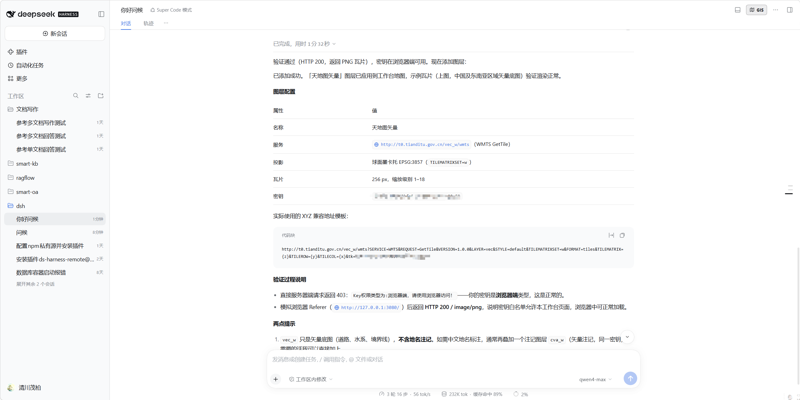

# GIS 工作台 / GIS workbench

A **DeepSeek Harness (DSH) workbench plugin** (`@focus-daima/gis-workbench`) that
embeds a MapLibre GL JS GIS console directly into the Harness web app. It lets the
Harness conversation inspect, style, import, and persist spatial datasets and map
layers on a shared map canvas.

一个 **DeepSeek Harness（DSH）工作台插件**（`@focus-daima/gis-workbench`），将
MapLibre GL JS GIS 控制台直接嵌入 Harness Web 应用，让 Harness 对话在共享地图画布上
查看、样式化、导入并持久化空间数据集与地图图层。

After the plugin is installed, open any Harness session and click the **GIS**
button in the **top-right corner** to enter the GIS workbench. Choose **Original
layout** in the workbench top bar to go back to the Harness session.

安装插件后，打开任意 Harness 会话，点击**右上角的 `GIS` 按钮**即可进入 GIS 工作台；
在工作台顶部选择 **Original layout（原版模式）**即可返回 Harness 会话。

The plugin adds:

- a MapLibre GL JS workbench panel with an **empty initial layer list**;
- a collapsible right-side conversation panel;
- a Host tool `gis_add_layer` that the conversation calls to add raster layers;
- a Client tool view that applies each successful add-layer result to the map store.

插件包含：

- 带初始空图层列表的 MapLibre GL JS 工作台面板；
- 可折叠的右侧对话面板；
- 供对话调用以添加栅格图层的 Host 工具 `gis_add_layer`；
- 客户端工具视图，把每次成功的添加图层结果应用到地图存储。

## 截图 / Screenshots

**Entry point — the GIS button in the Harness session header (top-right corner):**

**入口 —— Harness 会话头部（右上角）的 GIS 按钮：**



**GIS workbench — map canvas, layer panel, and map conversation:**

**GIS 工作台 —— 地图画布、图层面板与地图对话：**


## 在 DSH 配置中安装 / Installation in another DSH profile

The package is published to the internal Nexus npm hosted repository
`https://your-nexus-host/repository/frontend/`.

包发布在内部 Nexus npm 私有源 `https://your-nexus-host/repository/frontend/`。

Configure the scope once for the target user:

为目标用户一次性配置作用域：

```bash
npm config set @focus-daima:registry https://your-nexus-host/repository/frontend/
dsh plugin --profile web add @focus-daima/gis-workbench@0.9.10
dsh web
```

A local tarball also works:

本地 tarball 安装同样可用：

```bash
npm pack
dsh plugin --profile web add ./focus-daima-gis-workbench-0.9.10.tgz
```

Required runtime: Node.js with `node:sqlite`, GDAL CLI (`ogr2ogr`,
`gdal_translate`, `gdalinfo`, `gdal2tiles.py`), and Python 3 with GDAL
bindings. PostGIS registration additionally needs `psycopg`.

运行时要求：带 `node:sqlite` 的 Node.js、GDAL CLI（`ogr2ogr`、`gdal_translate`、
`gdalinfo`、`gdal2tiles.py`），以及带 GDAL 绑定的 Python 3；PostGIS 注册还需 `psycopg`。

The default Tianditu tile service is deployment-specific. Replace
`DEFAULT_TILE_URL` in `shared.js` or configure the tile URL through the API if
the target Harness cannot reach the current internal service.

默认天地图服务与部署环境相关。若目标 Harness 无法访问当前内部服务，请在 `shared.js`
中替换 `DEFAULT_TILE_URL`，或通过 API 配置瓦片地址。

## 源码与构建 / Source and build

`client.js` is generated by esbuild from `src/client.entry.js`. It bundles
`maplibre-gl@5.24.1` and inlines `maplibre-gl/dist/maplibre-gl.css`. MapLibre is the
open-source fork of Mapbox GL JS and needs no access token.

`client.js` 由 esbuild 从 `src/client.entry.js` 打包生成，内置 `maplibre-gl@5.24.1`
并内联其 CSS。MapLibre 是 Mapbox GL JS 的开源分支，无需访问令牌。

Mapbox GL JS 3.x revokes the renderer when no valid access token is configured:
the map keeps requesting raster tiles (they answer 200) but paints a blank
canvas. That is why this plugin uses MapLibre instead. Switching back to
Mapbox requires setting a real token before creating the map.

Mapbox GL JS 3.x 在未配置有效访问令牌时会撤销渲染器：地图持续请求栅格瓦片（返回 200），
但画布为空白。因此本插件改用 MapLibre；若切回 Mapbox，需在建图前配置真实令牌。

The dependency and bundler were installed from the Nexus npm registry:

依赖与打包工具从 Nexus npm 源安装：

```bash
npm install --registry=https://your-nexus-host/repository/nexus-npm/ \
  maplibre-gl@5.24.1 esbuild@0.28.2
```

Build from the repository root after making the installed `node_modules`
available to esbuild:

在仓库根目录、确保 `node_modules` 可供 esbuild 使用后执行构建：

```bash
./node_modules/.bin/esbuild src/client.entry.js \
  --bundle --format=iife --platform=browser --target=es2020 \
  --loader:.css=text --define:process.env.NODE_ENV='"production"' \
  --minify --legal-comments=inline --outfile=client.js
```

## 默认底图 / Default tile layer

`shared.js` owns the default Tianditu image template:

`shared.js` 中维护默认天地图影像模板：

```text
//your-tile-host/api/gis-map-service/world-map-tiles/images/tiandi-image-3857/{z}/{x}/{y}
```

Calling `gis_add_layer` with no arguments adds this layer. The Client resolves the
protocol-relative template against the page protocol before handing it to the
map engine.

不带参数调用 `gis_add_layer` 即添加该图层；客户端会先按页面协议解析协议相对模板，
再交给地图引擎。

## 共享地图对话 / Shared map chat

The right-hand map chat uses the **current Session** rather than a separate
Session. DSH's right sidebar is session-bound: showing a separate Session's chat
requires navigating the main workspace to that Session, which can expose a
duplicate conversation if the workbench overlay is lost. Using the current
Session keeps the main workspace fixed while the overlay covers it.

右侧地图对话使用**当前会话**，而非独立会话。DSH 右侧边栏与会话绑定：展示另一个会话的
对话需要主工作区切换到该会话，一旦工作台浮层丢失就可能出现重复对话。使用当前会话可在
浮层覆盖期间保持主工作区不变。

- Opening the workbench opens the map-chat tab in the current Session's right
  sidebar and leaves the main Session unchanged.
- The chat and the center conversation share model context, history, and draft,
  but the overlay hides the center while the workbench is open.
- **Original layout** closes the overlay, closes the map-chat tab, and restores
  the previous right-sidebar tab.
- Map layers live in one module-level store, so tool calls from the chat update
  the same workbench map.

- 打开工作台会在当前会话右侧边栏打开地图对话页签，主会话保持不变；
- 对话与中间会话共享模型上下文、历史记录和草稿，但工作台打开时浮层隐藏中间区域；
- **Original layout** 关闭浮层与地图对话页签，并恢复之前的右侧边栏页签；
- 地图图层存于同一个模块级存储，对话中的工具调用更新的是同一张工作台地图。

## 界面入口 / Layout entry points

- **GIS** button in the session header enters the workbench.
- **Original layout** in the workbench top bar returns to the previous Session.
- The right panel can be collapsed from its own chevron or the top-bar
  **Conversation** control.

- 会话头部的 **GIS** 按钮进入工作台；
- 工作台顶部的 **Original layout** 返回上一个会话；
- 右侧面板可通过自身折叠箭头或顶部栏的 **Conversation** 控件收起。

## 项目、数据集与图层 / Projects, datasets, and layers

State is persisted in SQLite at `<Host workspace>/.gis-workbench/gis.sqlite`
(the Host workspace is `/app` in the current deployment; uploaded files go to
`.gis-workbench/uploads`). The Host plugin exposes:

状态持久化到 SQLite：`<Host workspace>/.gis-workbench/gis.sqlite`（当前部署中 Host
工作区为 `/app`，上传文件存放于 `.gis-workbench/uploads`）。Host 插件提供以下接口：

```text
GET    /api/gis-workbench
POST   /api/gis-workbench/projects
GET    /api/gis-workbench/projects/:id/datasets
POST   /api/gis-workbench/projects/:id/datasets
POST   /api/gis-workbench/projects/:id/datasets/upload
POST   /api/gis-workbench/projects/:id/datasets/tile
GET    /api/gis-workbench/projects/:id/layers
POST   /api/gis-workbench/projects/:id/layers
PATCH  /api/gis-workbench/layers/:id
DELETE /api/gis-workbench/layers/:id
DELETE /api/gis-workbench/datasets/:id
GET    /api/gis-workbench/datasets/:id/content
GET    /api/gis-workbench/browse?path=...
```

Tables follow the requested model: `projects`, `datasets`, `layers`. SQLite has
no built-in geometry type, so `bbox` is a JSON array
`[west, south, east, north]` (WGS84). `meta`, `profile`, and `style` are JSON
text columns. Foreign keys cascade dataset deletion to its layers.

表结构对应 `projects`、`datasets`、`layers`。SQLite 无内置几何类型，`bbox` 为
WGS84 JSON 数组 `[west, south, east, north]`；`meta`、`profile`、`style` 为 JSON
文本列；外键在删除数据集时级联删除其图层。

Datasets can be:

数据集来源包括：

- browsed from an allowed server directory (default roots: the Host workspace,
  `/home/agent`, `/data`, `/mnt/data`, `/srv/data`; override with the
  colon-separated `GIS_WORKBENCH_ROOTS` environment variable);
- uploaded as GeoJSON, JSON, CSV, GeoTIFF, PNG/JPEG/WebP, `.shp`, or `.zip`;
- registered from an XYZ tile URL.

- 从允许的服务器目录浏览（默认根目录：Host 工作区、`/home/agent`、`/data`、
  `/mnt/data`、`/srv/data`；可用冒号分隔的环境变量 `GIS_WORKBENCH_ROOTS` 覆盖）；
- 上传 GeoJSON、JSON、CSV、GeoTIFF、PNG/JPEG/WebP、`.shp` 或 `.zip`；
- 通过 XYZ 瓦片 URL 注册。

The map renders tile datasets, GeoJSON datasets through the same-origin content
route, and image datasets with a known bbox. GeoTIFF and Shapefile datasets are
registered and managed but need tiling/conversion before they can be drawn.

地图渲染瓦片数据集、经同源内容路由的 GeoJSON 数据集，以及已知 bbox 的影像数据集。
GeoTIFF 与 Shapefile 数据集可注册管理，但需先切片/转换才能绘制。

## 保存工程图层状态 / Saving project layer state

Layer visibility, ordering, and removal are edited locally so the map updates
immediately. The top-bar **Save project** button commits the complete project
layer list atomically through `PUT /api/gis-workbench/projects/:id/state`;
the Host replaces that project's layers in one SQLite transaction. Leaving the
workbench, switching projects, opening the dataset manager, or creating a
project saves unsaved layer edits first. A dirty indicator and a browser
unload warning remain until the save succeeds.

图层可见性、排序与删除先在本地编辑，地图即时更新。顶部 **Save project** 按钮通过
`PUT /api/gis-workbench/projects/:id/state` 原子提交完整工程图层列表，Host 在一个
SQLite 事务内替换该工程图层。离开工作台、切换工程、打开数据集管理或新建工程时，会先
保存未提交的图层修改；在保存成功前会保留未保存标记和浏览器离开提醒。

## 分片续传上传 / Chunked, resumable uploads

The upload tab no longer sends the whole file in one multipart request, so the
old 200 MB request-body limit does not apply. Files are capped at **100 GB** and
uploaded in 8 MB chunks:

上传页签不再以单次 multipart 请求发送整文件，不再受旧的 200 MB 请求体限制。文件上限
**100 GB**，按 8 MB 分片上传：

```text
POST   /api/gis-workbench/projects/:id/uploads/init
GET    /api/gis-workbench/uploads/:id
PUT    /api/gis-workbench/uploads/:id/chunks/:index
POST   /api/gis-workbench/uploads/:id/complete
DELETE /api/gis-workbench/uploads/:id
```

`uploads` rows in SQLite track the file fingerprint, chunk size, received chunk
indexes, and temporary path. Re-selecting the same file resumes from the server's
recorded chunks; the client also remembers the upload id in `localStorage`. The
upload tab shows byte/percentage progress and a pause button. The Host accepts
each chunk up to 64 MB and writes it at its final offset, so neither memory nor
the HTTP body limit scales with the whole file.

SQLite 的 `uploads` 记录文件指纹、分片大小、已接收分片序号和临时路径。重新选择同一文件
会从服务端记录的分片续传；客户端还在 `localStorage` 记住上传 id。上传页签显示字节/百分比
进度和暂停按钮。Host 单分片最大接受 64 MB 并按最终偏移写入，内存与 HTTP 体限制都不随
整文件大小增长。

## GeoTIFF 转 COG 与展示 / GeoTIFF → COG and display

A `.tif`/`.tiff` dataset is converted during registration (and can be converted
again for an existing dataset from the dataset card):

`.tif`/`.tiff` 数据集在注册时转换（也可在数据集卡片上对已有数据集再次转换）：

1. `gdal_translate -of COG` writes `derived/<datasetId>/data.cog.tif` with
   DEFLATE compression and COG overviews;
2. `gdalinfo -json` supplies the WGS84 extent and CRS;
3. `gdal2tiles.py --xyz -p mercator -z 0-<cap>` writes an XYZ PNG pyramid under
   `derived/<datasetId>/tiles`;
4. the dataset profile becomes `format: "cog"` with `minzoom`, `maxzoom`,
   `tilesUrl`, and the map adds a raster source using
   `/api/gis-workbench/datasets/:id/tiles/{z}/{x}/{y}.png`;
5. the map fits the layer's WGS84 bounds.

1. `gdal_translate -of COG` 写出 `derived/<datasetId>/data.cog.tif`，DEFLATE 压缩并生成 COG 概视图；
2. `gdalinfo -json` 提供 WGS84 范围与坐标系；
3. `gdal2tiles.py --xyz -p mercator -z 0-<cap>` 在 `derived/<datasetId>/tiles` 下生成 XYZ PNG 金字塔；
4. 数据集 profile 变为 `format: "cog"`，含 `minzoom`、`maxzoom`、`tilesUrl`，地图以
   `/api/gis-workbench/datasets/:id/tiles/{z}/{x}/{y}.png` 添加栅格源；
5. 地图缩放到该图层的 WGS84 范围。

The zoom cap is derived from the raster's geographic coverage (at most zoom 22,
and fewer levels for large extents, keeping the pyramid under roughly 6,000
tiles) to bound tile generation. The original TIF is preserved in the upload
directory; the dataset URI points at the derived COG.

缩放级别上限依据影像地理覆盖范围推算（最高 zoom 22，大范围覆盖级别更少，金字塔约
6,000 片以内），以控制切片生成量。原始 TIF 保留在上传目录，数据集 URI 指向派生的 COG。

## 矢量导入：SHP、GeoJSON、GeoPackage 与 ZIP / Vector import: SHP, GeoJSON, GeoPackage, and ZIP

Vector uploads are normalized into a project-scoped GeoPackage
(`data/projects/<projectId>.gpkg`) with one layer per imported dataset. The
original upload stays in the upload directory as the immutable source; the
catalog SQLite stores the dataset/layer metadata and the GeoPackage table name.

矢量上传统一归一到工程级 GeoPackage（`data/projects/<projectId>.gpkg`），每个导入
数据集对应一个图层。原始上传文件作为不可变源保留在上传目录；目录 SQLite 存储数据集/图层
元数据与 GeoPackage 表名。

- `.geojson` / GeoJSON `.json`: imported with `ogr2ogr` to GPKG, converted to
  EPSG:4326, with a spatial index and a derived GeoJSON display preview.
- `.shp`: imported when its sidecars (`.shx`, `.dbf`, `.prj`, `.cpg`) are
  present. ZIP is the recommended upload for Shapefiles.
- `.gpkg`: every vector layer in the GeoPackage is imported as a separate
  dataset.
- `.zip`: safely extracted with a Python helper, then every contained SHP,
  GeoJSON, and GPKG layer is detected and imported. All supported sources in one
  archive produce multiple datasets/layers and are returned as arrays by the API.
- SHP/GeoJSON/GPKG are transformed to EPSG:4326 using `ogr2ogr -makevalid`; the
  GeoPackage remains the canonical editable/queryable store.
- MapLibre currently draws the derived GeoJSON preview. Large layers should be
  upgraded to MVT tiles later; the GPKG is already indexed for that step.

- `.geojson` / GeoJSON `.json`：用 `ogr2ogr` 导入 GPKG，转到 EPSG:4326，建立空间索引并生成 GeoJSON 预览；
- `.shp`：伴随文件（`.shx`、`.dbf`、`.prj`、`.cpg`）齐全时导入，Shapefile 建议打包 ZIP 上传；
- `.gpkg`：GeoPackage 中每个矢量图层作为独立数据集导入；
- `.zip`：由 Python 工具安全解压，检测并导入其中所有 SHP、GeoJSON、GPKG 图层；一个压缩包内
  全部支持的来源会产生多个数据集/图层，API 以数组返回；
- SHP/GeoJSON/GPKG 经 `ogr2ogr -makevalid` 转到 EPSG:4326，GeoPackage 作为可编辑/可查询的规范存储；
- MapLibre 当前绘制派生的 GeoJSON 预览，大图层后续应升级为 MVT 瓦片，GPKG 已为此建好索引。

## 建筑注记 / Building labels

A vector layer whose name contains `building` and whose fields include `CODE`
gets a MapLibre symbol layer on top of its fill/line rendering. The `CODE`
value is translated for display:

名称含 `building` 且字段含 `CODE` 的矢量图层，会在填充/线渲染之上叠加 MapLibre 符号
注记图层。`CODE` 值按以下对照表转译显示：

| CODE | Label / 标签 |
| --- | --- |
| Building | 建筑 |
| Deck | 露台 |
| Patio | 庭院 |
| Cement Pad | 混凝土地坪 |
| Greenhouse | 温室 |
| Foundation | 地基 |
| Ruins | 废墟 |

Unknown codes keep their original text, and null/empty codes draw no label.
Labels start at zoom 15; from zoom 12.5 only footprints larger than 10,000
(`ShapeSTAre`) are labelled so the overview stays readable. CJK glyphs are
rasterized locally by MapLibre, so no glyph PBF endpoint is required.

未识别的 code 保留原文，空值不绘制注记。注记从 zoom 15 开始显示；zoom 12.5 起仅对面积
大于 10,000（`ShapeSTAre`）的轮廓标注，以保持概览可读。中文字形由 MapLibre 本地光栅化，
无需字形 PBF 服务端点。

## 语义化图层样式工具 / Semantic layer styling tools

The Host exposes MCP-style map styling tools (visible to the conversation
agent), backed by the shared `style-schema.js` contract:

Host 暴露 MCP 风格的地图样式工具（对话 Agent 可见），基于共享的 `style-schema.js` 契约：

```text
gis_list_layers          find layers by name/project/field
gis_describe_layer       inspect format, fields, bbox, feature count, style
gis_sample_field         distinct field values for translation/valueMap
gis_map_capabilities     style schema, fonts, glyph URL, examples
gis_update_layer_style   persist a semantic style patch for one layer
```

`gis_update_layer_style` accepts `fillColor`, `fillOpacity`, `lineColor`,
`lineWidth`, `lineOpacity`, `circleColor`, `circleRadius`, `circleOpacity`,
`circleOpacity`, `lineVisible`, `circleVisible`, `categorical`, `opacity`, and `label`. Label supports `field`, `valueMap`, `fallback`, `size`,
`color`, `haloColor`, `haloWidth`, `minzoom`, `maxzoom`, `allowOverlap`, `font`,
and `anchor`. Example:

`gis_update_layer_style` 支持 `fillColor`、`fillOpacity`、`lineColor`、`lineWidth`、
`lineOpacity`、`circleColor`、`circleRadius`、`circleOpacity`、`lineVisible`、
`circleVisible`、`categorical`、`opacity`、`label`。注记支持 `field`、`valueMap`、
`fallback`、`size`、`color`、`haloColor`、`haloWidth`、`minzoom`、`maxzoom`、
`allowOverlap`、`font`、`anchor`。示例：

```json
{
  "fillColor": "#d8cbb4",
  "label": {
    "field": "CODE",
    "valueMap": {
      "Building": "建筑",
      "Deck": "露台",
      "Patio": "庭院"
    },
    "size": 12,
    "minzoom": 14
  }
}
```

Styles are persisted in `layers.style` and a client tool view applies the patch
to the live layer store. MapLibre renders labels as a symbol layer. Latin glyph
ranges are served from `assets/glyphs` at
`/api/gis-workbench/glyphs/{fontstack}/{range}.pbf`; missing CJK ranges fall
back to MapLibre's local ideograph renderer (`localIdeographFontFamily`).

样式持久化到 `layers.style`，客户端工具视图把补丁应用到实时图层存储。MapLibre 以符号
图层渲染注记。拉丁字形从 `assets/glyphs` 经
`/api/gis-workbench/glyphs/{fontstack}/{range}.pbf` 提供；缺失的中文范围回退到
MapLibre 本地表意文字渲染（`localIdeographFontFamily`）。

## 地图样式技能 / Map styling skill

A local skill at `/home/agent/.dsh/skills/gis-map-styling/SKILL.md` encodes the
general workflow: find layer → inspect fields → sample values → translate via
`valueMap` → persist the semantic style. The model-facing skill and the Host MCP
tools share the same style contract, so new layer-label or recolor requests do
not need a dedicated tool.

本地技能 `/home/agent/.dsh/skills/gis-map-styling/SKILL.md` 记录通用流程：找图层 →
查看字段 → 采样取值 → 经 `valueMap` 转译 → 持久化语义样式。面向模型的技能与 Host MCP
工具共享同一套样式契约，新增注记或改色需求无需专用工具。

## PostgreSQL / PostGIS 注册

The dataset manager has a **Database** tab. It registers a PostgreSQL
connection per project and lists spatial tables from PostGIS
`geometry_columns`. Selecting a table imports it into the project GeoPackage
with the same vector pipeline used for uploads, then adds it as a layer.

数据集管理提供 **Database** 页签，按工程注册 PostgreSQL 连接，并列出 PostGIS
`geometry_columns` 中的空间表。选择某张表后，复用上传同款矢量管线导入工程 GeoPackage，
再作为图层添加。

Endpoints:

接口：

```text
GET    /api/gis-workbench/projects/:id/databases
POST   /api/gis-workbench/projects/:id/databases
DELETE /api/gis-workbench/databases/:id
GET    /api/gis-workbench/databases/:id/tables
POST   /api/gis-workbench/databases/:id/tables/import
```

The registration stores host, port, database, username, password, and sslmode in
the catalog SQLite. Passwords are not returned by the API. Import uses
`ogr2ogr` with the GDAL PostgreSQL driver; the password is passed through
`PGPASSWORD`, not the command line. Tables are copied to the project GPKG, so a
later refresh/re-import is explicit rather than live-linked.

注册信息把主机、端口、数据库、用户名、密码和 sslmode 存入目录 SQLite，密码不通过 API
返回。导入使用 GDAL PostgreSQL 驱动的 `ogr2ogr`，密码经 `PGPASSWORD` 传递而非命令行。
表数据复制到工程 GPKG，后续刷新/重导为显式操作，而非实时联动。

## 将图层加入对话 / Add a layer to the conversation

Right-click any row in the layer panel and choose **添加到对话**. The workbench
collects the layer name, layerId (or session layer key), project, dataset
type/format, feature count, attribute fields, bbox, and a short current-style
summary, then appends that structured context to the active map-chat draft. The
single action also opens/focuses the map-chat tab. A small composer-bridge slot
captures the active Session's `inputActions` so the overlay can write the draft
without replacing the main workspace.

在图层面板任意行右键选择 **添加到对话**。工作台收集图层名称、layerId（或会话图层键）、
工程、数据集类型/格式、要素数量、属性字段、bbox 和当前样式摘要，把结构化上下文追加到
当前地图对话草稿；该操作同时打开/聚焦地图对话页签。一个小编排桥接槽位捕获当前会话的
`inputActions`，使浮层可写入草稿而不替换主工作区。

## 图层排序 / Layer ordering

Layer-panel rows are draggable. Dropping above/below another row reorders the
shared layer store immediately, normalizes `z`, and moves the corresponding
MapLibre layer groups to match. Reordering a project layer saves the project
layer order automatically; session-only ordering stays local.

图层面板行可拖拽。拖到另一行上方/下方会立即调整共享图层存储顺序、规整 `z` 值，并移动
对应 MapLibre 图层组与之匹配。工程图层排序自动保存；仅会话内排序保留在本地。

## 新建多边形矢量图层 / New polygon vector layers

The layer panel's **+** action creates a project-scoped GeoPackage polygon
layer (`sourceFormat: "drawn"`, fields `name` and `created_at`) and immediately
enters polygon drawing mode. Left-click adds vertices; right-click, **Finish**,
or the panel button closes the ring and saves the polygon through
`POST /api/gis-workbench/datasets/:id/features`. The layer preview and bbox are
rebuilt after each save, and the GeoJSON source is refreshed through a
feature-count/size version query. Escape cancels the drawing.

图层面板的 **+** 操作创建工程级 GeoPackage 多边形图层（`sourceFormat: "drawn"`，
字段 `name`、`created_at`）并立即进入绘面模式。左键加点；右键、**Finish** 或面板按钮
闭合环，通过 `POST /api/gis-workbench/datasets/:id/features` 保存多边形。每次保存后重建
图层预览与 bbox，并按要素数量/大小版本查询刷新 GeoJSON 源。Escape 取消绘制。

Drawn layers expose a pencil action in the layer panel to re-enter polygon
drawing and append more polygons to the same GeoPackage layer. During drawing
the map shows a rubber-band line from the last vertex and a live polygon preview
under the cursor; committed vertices and the preview use separate GeoJSON
sources so the preview can change on every mouse move.

已绘制图层在面板提供铅笔操作，可重新进入绘面模式，向同一 GeoPackage 图层追加多边形。
绘制时地图显示从上一顶点拉出的橡皮筋线和光标下的实时多边形预览；已提交顶点与预览使用
独立 GeoJSON 源，使预览可随每次鼠标移动变化。

Drawn polygons support right-click deletion. The map queries rendered features in
drawn layers, opens a small context menu on the polygon, and deletes the matching
feature by `name` + `created_at` through
`POST /api/gis-workbench/datasets/:id/features/delete`. The preview, feature
count, and actual bbox are rebuilt from the remaining features.

已绘制多边形支持右键删除。地图查询绘制图层中已渲染要素，在多边形上打开小型上下文菜单，
按 `name` + `created_at` 通过
`POST /api/gis-workbench/datasets/:id/features/delete` 删除匹配要素，并基于剩余要素
重建预览、要素数量与实际 bbox。

Drawn polygons support an edit mode from the pencil action: click a polygon to
show its vertices, drag a vertex marker to reshape it, or drag inside the
polygon to move the whole feature. Each drag finish saves geometry through
`POST /api/gis-workbench/datasets/:id/features/update`. Source refresh uses a
profile revision (`updatedAt`) instead of clearing project layers, preventing the
map from flashing white after edits or feature deletion.

已绘制多边形支持铅笔操作进入编辑模式：点击多边形显示顶点，拖动顶点标记重塑形状，或在
多边形内部拖动以整体移动要素。每次拖动结束通过
`POST /api/gis-workbench/datasets/:id/features/update` 保存几何。源刷新使用 profile 修订号
（`updatedAt`）而非清空工程图层，避免编辑或删除要素后地图闪白。
